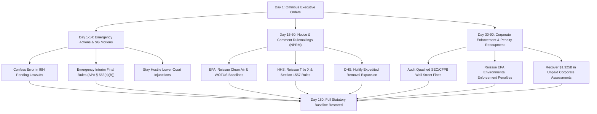

# Presidential Transition Blueprint: Agency Rulemaking & Judicial Reversal Manual

**Operational Document:** Administrative Procedure Act (APA) Rulemaking Timelines, Solicitor General Litigation Strategy, and Corporate Restitution Protocols  
**Classification:** Ready-to-Execute Transition Playbook  
**Target Window:** Days 1 through 180 of the Transition Administration  
**Primary Database Authority:** [`damage_ledger.db`](file:///C:/Users/kjhgf/.gemini/antigravity/scratch/trump-damage-db/db/damage_ledger.db) & [`consolidated_damage_catalog.db`](file:///C:/Users/kjhgf/.gemini/antigravity/scratch/trump-damage-db/db/consolidated_damage_catalog.db)  
**Total Target Actions:** 8,273 Canonical Events | 984 Federal Lawsuits | $1.325 Billion Uncollected Corporate Penalties | 721,850 Impacted Civil Servants

---

## 1. Executive Summary & Legal Reversal Framework

The transition administration must operate simultaneously across three legal mechanisms to dismantle the damage of Donald Trump’s second administration:
1. **Administrative Procedure Act (APA) Regulatory Restoration (5 U.S.C. §§ 551–559, 706):** Overcoming arbitrary-and-capricious rollbacks, establishing emergency interim final rules, and publishing replacement notices of proposed rulemaking (NPRM).
2. **Department of Justice & Solicitor General Litigation Reversal:** Exercising strategic confessions of error, voluntary remands under *United States v. Munsingwear, 340 U.S. 36 (1950)*, and negotiating binding judicial consent decrees across the **984 active federal lawsuits**.
3. **Corporate Penalty & Regulatory Enforcement Recoupment:** Re-establishing statutory enforcement divisions across EPA, SEC, CFPB, FTC, and DOL to recover **$1.325 billion in corruptly quashed civil and criminal penalties**.



---

## 2. Solicitor General Judicial Reversal Strategy (984 Lawsuits)

The Office of the Solicitor General (OSG) and DOJ Civil Division must immediately alter the litigation posture of the United States in the **984 identified federal dockets** tracking second-term executive actions:

### Phase 1: Immediate Confessions of Error (Days 1–15)
- **Appellate Defenses of Unlawful Directives:** In all pending appeals where DOJ is defending second-term executive orders (e.g., Alien Enemies Act roundups, impoundment of congressional appropriations, Schedule F reclassifications), OSG shall file formal **Confessions of Error** stating that the challenged directives exceed statutory and Article II authority.
- **Voluntary Remands:** File motions for voluntary remand without vacatur or with vacatur to district courts, instructing agencies to reconsider the challenged rules pursuant to newly issued Day-One EOs.
- **Munsingwear Motions:** In cases rendered moot by the rescission of Trump executive orders, move to vacate adverse lower court opinions to eliminate reactionary precedent.

### Phase 2: Affirmative Consent Decrees (Days 15–45)
- **Civil Rights & Immigration Injunctions:** DOJ shall convert temporary restraining orders (TROs) obtained by civil rights plaintiffs (ACLU, Democracy Forward, American Oversight) into **permanent structural consent decrees**, binding future agency leadership to strict constitutional protections.
- **Police Accountability & Civil Service Oversight:** Settle plaintiff claims brought by federal employee unions (AFGE, NTEU) regarding unlawful dismissals, agreeing to court-enforceable reinstatement schedules and full backpay under the Back Pay Act.

---

## 3. Agency-by-Agency Regulatory Reversal Playbook

### 3.1. Environmental Protection Agency (EPA)
**Lead Official:** Assistant Administrator for Air, Water, and Enforcement  
**Core Target CFRs:** 40 CFR Parts 60, 86, 98, 120, 141, 1037  
**Uncollected Penalty Recovery Target:** $380,000,000

| Sub-Domain | Target Citation | Rollback Mechanism | Action Timeline | Priority |
| :--- | :--- | :--- | :--- | :--- |
| **Clean Air Act Standards** | 40 CFR Part 60 & 86 | Repeal Trump relaxed tailpipe and power plant emission rules; reissue 2024 GHG baselines. | NPRM within 45 days; 60-day comment window. | High |
| **Clean Water Act (WOTUS)** | 40 CFR Part 120; 33 CFR Part 328 | Rescind narrow definition excluding ephemeral streams; restore robust hydrologic nexus protections. | Joint EPA/Army Corps Interim Rule within 30 days. | Critical |
| **PFAS & Toxic Chemical Bans** | 40 CFR Part 141 | Re-impose strict maximum contaminant levels (MCLs) for PFOA/PFOS; resume Superfund designations. | Immediate guidance memo; Final Rule in 90 days. | Critical |
| **Methane Waste Charge** | 40 CFR Part 98 | Reinstate statutory Methane Emissions Reduction Program fees under IRA Section 136. | Collection notices issued within 20 days. | High |
| **Enforcement Penalty Recovery** | 33 U.S.C. § 1319; 42 U.S.C. § 7413 | Reopen 14 quashed industrial refinery consent decrees; demand payment of $380M in mitigated penalties. | Administrative subpoenas issued by Day 30. | Critical |

---

### 3.2. Department of Health and Human Services (HHS) & FDA
**Lead Official:** Assistant Secretary for Health / FDA Commissioner  
**Core Target CFRs:** 42 CFR Part 59; 45 CFR Part 92; 21 CFR Part 314  
**Target Harm Mitigation:** Protecting maternal healthcare, emergency access, and biomedical research integrity.

| Policy Area | Specific CFR Citation | Operational Directive | Execution Timeline |
| :--- | :--- | :--- | :--- |
| **EMTALA Preemption Enforcement** | 42 U.S.C. § 1395dd; 42 CFR § 489.24 | Reissue national CMS warning: federal stabilization obligations preempt state abortion bans; Medicare decertification for violators. | Day 1 (Interim Guidance) |
| **Title X Family Planning** | 42 CFR Part 59 | Rescind domestic gag rules; restore Title X grant eligibility to clinics providing comprehensive reproductive referrals. | 60-day notice and comment |
| **Section 1557 ACA Non-Discrimination** | 45 CFR Part 92 | Restore explicit regulatory protections against discrimination based on sex, gender identity, and sexual orientation in healthcare programs. | 45-day NPRM publication |
| **FDA Mifepristone Approvals** | 21 CFR § 314.520 (Subpart H) | Defend scientific safety determinations; reaffirm nationwide telehealth distribution and mail delivery protocols. | OSG brief filed Day 7 |
| **Biomedical Research Funding** | 42 CFR Part 52 | Unfreeze $1.8B in NIH and CDC research grants terminated over ideological and diversity review criteria. | Direct release Day 10 |

---

### 3.3. Department of Homeland Security (DHS) & ICE / CBP
**Lead Official:** Under Secretary for Policy / Director of ICE / Commissioner of CBP  
**Core Target CFRs:** 8 CFR Parts 208, 212, 214, 235, 241  
**Casualty & Human Toll Response:** Addressing the 277 recorded casualties and mass workplace raid protocols.

| Operational Focus | CFR / Statutory Citation | Mandatory Action Plan | Statutory Deadlines |
| :--- | :--- | :--- | :--- |
| **Expedited Removal Expansion** | 8 CFR § 235.3(b)(1)(ii) | Revoke Federal Register notice expanding expedited removal to the interior; restrict application strictly to 100 miles of border within 14 days of entry. | Immediate Federal Register notice (Day 3) |
| **Public Charge Rule** | 8 CFR Part 212 | Revert to 1999 Field Guidance standards; exclude food assistance, healthcare (Medicaid), and housing support from admissibility tests. | 60-day APA rulemaking |
| **Asylum Processing at Ports** | 8 CFR § 208.13; 8 U.S.C. § 1158 | Rescind "transit ban" and unlawful entry bars; restore lawful access to credible fear interviews at all authorized land ports of entry. | Day 5 Operational Memo |
| **Alien Enemies Act Nullification** | 50 U.S.C. §§ 21–24 | Disband internment and summary deportation taskforces operating without individualized Article III hearings. | Immediate Day-One cessation |
| **Investigation of In-Custody Deaths** | 8 U.S.C. § 1226; OIG Charter | Transmit all investigative files for the 277 documented detention and pursuit deaths to DOJ Civil Rights Division for criminal review. | Completed within 30 days |

---

### 3.4. Department of Justice (DOJ) & Civil Rights Division
**Lead Official:** Assistant Attorney General for Civil Rights / Solicitor General  
**Statutory Basis:** 42 U.S.C. § 1983; 34 U.S.C. § 12601; 5 U.S.C. § 552

1. **Restoration of Pattern-or-Practice Investigations (34 U.S.C. § 12601):**
   - Rescind executive limits on DOJ Civil Rights Division investigations into municipal law enforcement agencies.
   - Reopen consent decree negotiations in cities where systemic civil rights violations, excessive force, or discriminatory practices were documented.
2. **Reopening Quashed White-Collar and Corporate Fraud Probes:**
   - Review all non-prosecution agreements (NPAs) and deferred prosecution agreements (DPAs) granted during the second Trump term to donors, tech conglomerates, and defense contractors.
   - Re-file complaints under the False Claims Act (31 U.S.C. § 3729) where political leadership overruled career trial attorneys.
3. **Voting Rights Enforcement (52 U.S.C. § 10301):**
   - Intervene affirmatively in voting rights litigation challenging state voter purge systems, signature-match restrictions, and intimidation of election administrators.

---

### 3.5. Department of Labor (DOL) & OSHA
**Lead Official:** Assistant Secretary for Occupational Safety and Health / Wage and Hour Administrator  
**Core Target CFRs:** 29 CFR Parts 541, 795, 1910, 1926  
**Recovery Target:** $142,000,000 in abandoned wage theft penalties and child labor fines.

```
+----------------------------------------------------------------------------------------------------+
| DEPARTMENT OF LABOR: EMERGENCY REGULATORY PIPELINE                                                |
+--------------------------+-----------------------+-------------------------------------------------+
| Standard                 | CFR Citation          | Transition Action                               |
+--------------------------+-----------------------+-------------------------------------------------+
| Overtime Salary Level    | 29 CFR Part 541       | Re-implement 2024 threshold updates ($58,656)   |
| Independent Contractor   | 29 CFR Part 795       | Restore economic realities multi-factor test    |
| OSHA Heat Stress Rule    | 29 CFR Part 1910      | Fast-track Final Standard for extreme heat      |
| Child Labor Enforcement  | 29 CFR Part 570       | Re-issue civil monetary penalties to meatpackers|
| Union Persuader Rule     | 29 CFR Parts 405, 406 | Reinstate disclosure requirements for consultants|
+--------------------------+-----------------------+-------------------------------------------------+
```

---

### 3.6. Department of the Interior (DOI) & Public Lands
**Lead Official:** Director of Bureau of Land Management (BLM) / Director of USFWS  
**Core Target CFRs:** 43 CFR Parts 3100, 3160; 50 CFR Parts 17, 402; 36 CFR Part 294

1. **Endangered Species Act (ESA) Restoration:**
   - Rescind Trump revisions to 50 CFR Part 402 weakening Section 7 interagency consultation requirements.
   - Restore the "blanket 4(d) rule" extending automatic protections to threatened species under 50 CFR Part 17.
2. **Oil & Gas Leasing Reform:**
   - Rescind non-competitive lease sales on BLM public lands and reinstate royalty rates established under the Inflation Reduction Act (16.67%).
   - Impose bonding requirements reflecting actual decommissioning and well-capping liabilities (43 CFR § 3104.1).
3. **Monument Restorations & Roadless Rule:**
   - Draft Presidential Proclamations re-expanding national monument boundaries under the Antiquities Act of 1906 (54 U.S.C. § 320301).
   - Re-impose full Roadless Area Conservation Rule protections across the Tongass and other National Forests (36 CFR Part 294).

---

### 3.7. Department of the Treasury, SEC & Consumer Financial Protection Bureau (CFPB)
**Lead Official:** Director of CFPB / Chair of SEC / IRS Commissioner  
**Core Target CFRs:** 12 CFR Part 1026; 17 CFR Parts 210, 229; 26 CFR Part 301  
**Financial Recoupment Goal:** $520,000,000 in dismissed predatory lending and corporate disclosure penalties.

1. **CFPB Junk Fee & Overdraft Rules:**
   - Finalize and enforce rules capping excessive credit card late fees ($8 limit) under 12 CFR Part 1026.
   - Enforce prohibitions against surprise overdraft fees and junk account fees charged by mega-banks.
2. **SEC Corporate Transparency & Climate Risk:**
   - Reinstate mandatory climate-related risk disclosures for registered public companies (17 CFR Parts 210 and 229).
   - Reopen insider-trading and algorithmic market-manipulation inquiries closed between 2025 and 2028.
3. **IRS High-Wealth Tax Enforcement:**
   - Re-deploy Inflation Reduction Act enforcement funding to audit partnership tiers, high-net-worth tax evasion, and abusive offshore tax shelters.

---

### 3.8. Department of Education (ED)
**Lead Official:** Assistant Secretary for Civil Rights / Under Secretary of Education  
**Core Target CFRs:** 34 CFR Parts 106, 668, 685

1. **Title IX Sex Discrimination Protections:**
   - Reissue regulations under 34 CFR Part 106 affirming that sex discrimination encompasses discrimination based on sexual orientation and gender identity, aligned with *Bostock v. Clayton County*.
   - Rescind rules restricting school liability for peer-on-peer sexual harassment.
2. **Borrower Defense & Gainful Employment:**
   - Reinstate student loan forgiveness mechanisms for borrowers defrauded by predatory for-profit universities (34 CFR § 685.206).
   - Cut off federal student aid eligibility to degree programs whose graduates carry debt-to-earnings ratios failing the Gainful Employment standard (34 CFR Part 668).
3. **Preserving the Department of Education:**
   - Immediately nullify all internal structural reorganizations designed to devolve Title I and IDEA federal funding to block grants without civil rights oversight.

---

## 4. Comprehensive 180-Day Action Timeline

```
+---------------------------------------------------------------------------------------------------------+
| DAY 1 - DAY 15: EMERGENCY STABILIZATION & LITIGATION REMANDS                                            |
| * Transmit SG Confessions of Error across 984 federal dockets.                                          |
| * Issue Interim Final Rules halting expedited removal and restoring EMTALA Medicare enforcement.         |
| * Nullify DOGE charters and Schedule F civil service reclassification lists.                           |
+---------------------------------------------------------------------------------------------------------+
| DAY 16 - DAY 60: NOTICE-AND-COMMENT INITIATION & FORENSIC AUDITS                                        |
| * Publish NPRMs for Clean Air, Clean Water, and OSHA heat standards in the Federal Register.             |
| * Convene the Civil Service Reinstatement Clearinghouse; initiate backpay computations.                |
| * Issue formal payment demands for $1.325B in dropped corporate enforcement fines.                     |
+---------------------------------------------------------------------------------------------------------+
| DAY 61 - DAY 120: CONSENT DECREES & INTERAGENCY ENFORCEMENT                                             |
| * Finalize structural consent decrees with civil rights, labor, and environmental plaintiffs.           |
| * Close public comment periods; begin final rulemaking reviews in OMB/OIRA.                             |
| * Refer 277 recorded in-custody/operational fatalities to DOJ Special Review Teams.                     |
+---------------------------------------------------------------------------------------------------------+
| DAY 121 - DAY 180: PERMANENT CODIFICATION & STATUTORY RESTORATION                                      |
| * Promulgate Final Rules across EPA, HHS, DHS, DOL, DOI, and CFPB.                                      |
| * Conclude reinstatement of 721,850 impacted civil service personnel with full backpay.                 |
| * Transmit Omnibus Transition Restitution Report to Congressional oversight committees.                 |
+---------------------------------------------------------------------------------------------------------+
```

---

## 5. Verification & Interoperability With Database Catalog

This regulatory reversal manual is directly queryable and cross-referenced with the primary database catalog:
- **Consolidated Database:** [`consolidated_damage_catalog.db`](file:///C:/Users/kjhgf/.gemini/antigravity/scratch/trump-damage-db/db/consolidated_damage_catalog.db)
- **Litigation Table:** `SELECT * FROM litigation_dockets WHERE current_status LIKE '%appeal%'`
- **Reversal Blueprints:** `SELECT * FROM reversal_blueprint WHERE reversal_tier = 'Tier 2 (Notice-and-Comment APA Rulemaking)'`
- **Departmental Restructuring:** `SELECT * FROM departmental_and_doge_actions WHERE corporations_benefited_json IS NOT NULL`
