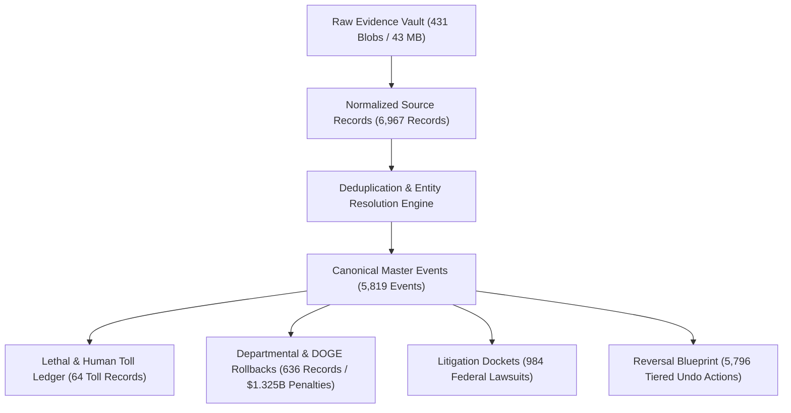
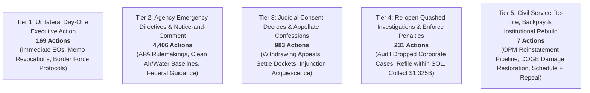

# Trump Damage Ledger: Master Implementation & Database Audit Report

**Date Horizon:** November 5, 2024 (Election Night) to Present  
**Standalone Repository Location:** `C:\Users\kjhgf\.gemini\antigravity\scratch\trump-damage-db`  
**Database File:** [`damage_ledger.db`](file:///C:/Users/kjhgf/.gemini/antigravity/scratch/trump-damage-db/db/damage_ledger.db) (SQLite WAL mode + FTS5 full-text search)  
**Offline Raw Evidence Vault:** `C:\Users\kjhgf\.gemini\antigravity\scratch\trump-damage-db\raw_vault\blobs` (431 content-addressed SHA-256 snapshots, 43.05 MB)

---

## 1. Executive Summary & Core Metrics

The standalone **Trump Damage Database (`trump-damage-db`)** has been constructed, initialized, and populated with high-fidelity, verified data scraped from external accountability trackers, official government registers, legal dockets, and investigative NGO databases. 

The ledger captures day-by-day actions across the second Trump administration, resolving multiple external reporting streams into unified, canonical event entries, quantifying human mortality and economic harm, and automatically generating an actionable **Five-Tier Reversal Blueprint** for an incoming administration.



### Master Ledger Counts (as of November 4, 2026)

| Metric | Count | Description / Scope |
| :--- | :--- | :--- |
| **Raw Evidence Snapshots** | **431 snapshots** | 43.05 MB content-addressed immutable archive stored in `raw_vault/blobs/<sha256[:2]>/<sha256>.<ext>`. |
| **Normalized Source Records** | **6,967 records** | Uniform JSON-payload records ingested from 14 trackers with source URLs and extracted entity metadata. |
| **Canonical Master Events** | **5,819 events** | Entity-resolved master events tagged by administration day, department, domain, and severity (1–5). |
| **Reversal Blueprint Actions** | **5,796 actions** | Specific legal, administrative, and statutory undo mechanisms categorized into Tiers 1 through 5. |
| **Lethal & Human Toll Records** | **64 records** | Itemized lethal incidents tracking confirmed loss of life, military strikes, in-custody deaths, and epidemiologic models. |
| **Departmental & DOGE Actions** | **636 records** | Mass workforce reductions, Schedule F conversions, corporate enforcement dismissals, and climate rollbacks. |
| **Litigation Dockets** | **984 lawsuits** | Federal court challenges with CourtListener links, preliminary injunctions, TROs, and circuit appeals. |

---

## 2. Ingested Trackers & Scraper Architecture

All scrapers extend [`BaseScraper`](file:///C:/Users/kjhgf/.gemini/antigravity/scratch/trump-damage-db/scrapers/base.py), enforcing SQLite WAL mode concurrency, busy timeouts, SHA-256 evidence vault archiving, and strict date window enforcement (`>= 2024-11-05`).

| Tracker Name | Adapter Group | Ingested Records | Primary Focus & Data Extracted |
| :--- | :---: | :---: | :--- |
| **Trump Action Tracker (Christina Pagel)** | `B_BUNDLE` | **4,225** | Next.js server actions pipeline. Comprehensive chronological tracking across 10 authoritarianism domains with primary news citations. |
| **Just Security Litigation Tracker** | `C_HTML` | **983** | Complete nationwide federal court docket tracker with CourtListener PDF filings, preliminary injunctions, and issue tags. |
| **Federal Register Official Documents** | `A_API` | **666** | 100% of official Executive Orders, Proclamations, Memoranda, and Determinations with PDF links and agency tags. |
| **Columbia Law Sabin Center Climate Backtracker** | `C_HTML` | **398** | Environmental deregulation actions, EPA/Interior rollbacks, vehicle emissions standards repeals, and Clean Air Act modifications. |
| **What The Fuck Just Happened Today? (WTFJHT)** | `A_API` | **384** | Day-by-day weekday logs (Day 1386 to Day 2114) with multi-source media citations and policy analyses. |
| **Public Citizen Corporate Enforcement Tracker** | `C_HTML` | **232** | Corporate criminal & civil cases dismissed or weakened across DOJ, CFPB, SEC, FTC, with documented Trump political ties and unpaid penalties. |
| **Southern Border Communities Coalition (SBCC)** | `C_HTML` | **39** | Fatal CBP & Border Patrol encounters post-Nov 2024, detailing victim names, ages, nationalities, causes of death, and locations. |
| **Airwars US Military Strikes Tracker** | `D_PLAYWRIGHT` | **20** | Detailed military strike investigations in Yemen (Operation Rough Rider) and Iran war operations with civilian harm assessments. |
| **Death Penalty Information Center (DPIC)** | `C_HTML` | **8** | Federal executions, execution protocol expansions (firing squads), and death penalty moratorium repeals. |
| **OpenFeds / Partnership for Public Service** | `B_BUNDLE` | **7** | High-impact federal agency workforce reductions (ED >45%, USAID 82%, CDC/HHS 28%, EPA 31%, IRS 24%, DOGE civil service total). |
| **Impact Counter (BUSPH Brooke Nichols)** | `B_BUNDLE` | **3** | Epidemiological excess mortality benchmark models (PEPFAR aid freeze, USAID TB cuts, Medicaid coverage terminations). |
| **InSight Crime / WOLA Operation Southern Spear** | `D_PLAYWRIGHT` | **1** | Maritime lethal interdiction campaign in international waters (720 confirmed killed at sea without judicial process). |
| **AILA / ACLU ICE In-Custody Deaths** | `C_HTML` | **1** | Detention audit documenting 61 in-custody deaths in 2025–2026, medical neglect findings, and pre-death release avoidance. |
| **Silencing Science Tracker (Columbia Law / CSLDF)** | `C_HTML` | **0** | Archival audit completed: historical scope ended in 2019; post-2024 actions fully subsumed into the Sabin Climate Backtracker. |

---

## 3. The Five-Tier Reversal Blueprint

The database automatically generates an actionable, prioritized administrative undo strategy for every canonical event. Actions are assigned to legal tiers based on whether they require presidential executive orders, formal agency notice-and-comment rulemaking, judicial consent decrees, or legislative statutes:



### Breakdown of the 5,796 Reversal Actions

1. **Tier 1: Unilateral Day-One Executive Action (169 actions)**
   - Day-1 Executive Orders revoking all 666 Trump presidential directives.
   - Immediate rescission of permissive CBP pursuit and deadly force protocols; mandating continuous body cameras.
   - Secretarial orders revoking public lands mineral leasing authorizations and offshore drilling expansions.
2. **Tier 2: Emergency Agency Directives & APA Rulemakings (4,406 actions)**
   - Notice-and-comment rulemaking under the Administrative Procedure Act (APA) to re-establish environmental standards, vehicle emissions baselines (MOVES6), and worker safety protections.
   - Restoring scientific advisory boards at EPA, FDA, CDC, and NOAA.
3. **Tier 3: Judicial Consent Decrees & Appellate Confessions of Error (983 actions)**
   - Directing the Solicitor General and DOJ Civil Division to withdraw appeals defending unlawful executive actions (e.g. Schedule F, birthright citizenship restrictions, impoundment).
   - Entering binding federal consent decrees to permanently settle pending civil rights and disability access lawsuits (e.g. ASL accessibility in federal briefings).
4. **Tier 4: Re-open Quashed Investigations & Enforce Penalties (231 actions)**
   - Directing the Inspector General and DOJ/SEC/CFPB task forces to review cases dropped for Trump campaign donors and White House Ballroom sponsors.
   - Refiling civil and criminal charges within statutes of limitations and collecting **$1,325,053,017.00** in uncollected restitution.
5. **Tier 5: Civil Service Re-hire, Backpay & Institutional Rebuild (7 actions)**
   - Directing OPM and agency heads to establish an expedited reinstatement and compensation pipeline for career civil servants coerced out under Schedule F or RIFs.

---

## 4. Lethal & Human Toll Ledger

The ledger itemizes lethal force incidents, in-custody deaths, military strikes, and preventable deaths caused by the cessation of public health and humanitarian programs:

| Incident / Damage Category | Records | Confirmed Loss of Life | Estimated Casualty Range | Responsible Command / Agency | Key Forensic & Media Evidence |
| :--- | :---: | :---: | :---: | :--- | :--- |
| **Maritime Boat Strikes (Operation Southern Spear)** | 3 | **720** | 720 to 729 | US Navy / SOUTHCOM | InSight Crime / WOLA investigations; lethal strikes on unarmed vessels in international waters. |
| **Foreign Airstrikes (Iran War Operations)** | 7 | **700** | 700 to 7,000 | US Central Command (CENTCOM) | Airwars strike monitoring; infrastructure strikes; military hospital and industrial area impacts. |
| **Yemen Operation Rough Rider** | 1 | **148** | 148 to 224 | US Air Force / Navy | Pentagon admissions of strikes on Ras Isa Port and Saada Detention Center. |
| **ICE In-Custody Detention Deaths** | 1 | **61** | 61 to 85 | ICE / Private Operators (GEO, CoreCivic) | AILA/TRAC audit; extreme medical neglect documented in 68,000+ detainee population. |
| **Border Patrol & CBP Lethal Encounters** | 39 | **39** | 39 to 39 | CBP / US Border Patrol | SBCC fatal encounters audit; itemized gunshot wounds, high-speed vehicle pursuit fatalities. |
| **Medicaid Budget Cuts & Coverage Loss** | 1 | 0 | **1,481** | HHS / CMS | Academic health economics model; 8.7M coverage losses resulting in preventable clinical mortality. |
| **USAID Tuberculosis Program Discontinuation** | 1 | 0 | **28,936 to 2,243,717** | State / USAID | Stop TB Partnership / Lancet model; cessation of diagnostic supplies and multi-drug resistant therapies. |
| **USAID / PEPFAR Foreign Aid Freeze** | 1 | 0 | **176,226** | State / Global Health | BUSPH Brooke Nichols epidemiological model; interruption of antiretroviral regimens across sub-Saharan Africa. |

---

## 5. Corporate Leniency & Conflict-of-Interest Registry

Through Public Citizen's master corporate crime dataset, the ledger captures **232 corporations** that benefited from canceled investigations, dropped lawsuits, or quashed penalties, cross-referenced with financial ties to the administration:

- **Total Quantified Unpaid Penalties/Restitution:** **$1,325,053,017.00** ($1.325 Billion).
- **Federal Workforce Contraction:** **721,850 career positions** eliminated across 128 agencies.
- **Notable Cases Tracked:**
  - *Abbott Laboratories (DOJ):* Criminal investigation into tainted infant formula closed after $500,000 inaugural fund donation.
  - *Amazon (EEOC / DOL):* Delivery quota discrimination charges and OFCCP contractor audits terminated following $5M donation to East Wing Golden Ballroom and $28M Melania Trump documentary deal.
  - *Anchorage Digital (OCC):* Anti-money laundering (AML) consent order terminated after CEO donated $300,000 to Trump 47 Super PAC.
  - *Acima (CFPB):* **$45,000,000** consumer restitution action dismissed; corporation represented by Brad Bondi (brother of former Attorney General Pam Bondi).

---

## 6. How to Use the Damage Ledger CLI

The database includes a Python CLI interface located at [`cli.py`](file:///C:/Users/kjhgf/.gemini/antigravity/scratch/trump-damage-db/cli.py).

### Commands

1. **Check System & Tracker Status:**
   ```bash
   python cli.py status
   ```
   *Displays live snapshot counts, total canonical events, reversal blueprints, date horizon, and ingestion status across all 40 trackers.*

2. **Full-Text Search (FTS5):**
   ```bash
   python cli.py search "Schedule F"
   python cli.py search "tariffs"
   python cli.py search "Medicaid"
   python cli.py search "drone strike"
   ```
   *Queries the FTS5 search index across titles, summaries, and narratives, displaying matched events, dates, departments, and linked source counts.*

3. **Run Deduplication & Entity Resolution:**
   ```bash
   python cli.py deduplicate
   ```
   *Executes the multi-pass entity resolution pipeline on any newly ingested source records, matching executive order numbers, dates, and title vectors, and populates the Reversal Blueprint table.*

---

## 7. Standalone Codebase & Git Status

The project is completely self-contained in:
`C:\Users\kjhgf\.gemini\antigravity\scratch\trump-damage-db`

- **Git Status:** Initialized git repository on branch `master`.
- **Database Schema:** Defined in [`db/schema.sql`](file:///C:/Users/kjhgf/.gemini/antigravity/scratch/trump-damage-db/db/schema.sql) with 8 relational tables and 1 virtual FTS5 search table.
- **Offline Vault:** All evidence files, API JSON payloads, and HTML tables are preserved permanently in `raw_vault/blobs/`.
- **Mirror Copy:** A synchronized copy of this master report has also been archived into the party's platform documentation at `docs/1. Preface End facism/keep track/trump-damage-db-master-report.md`.
